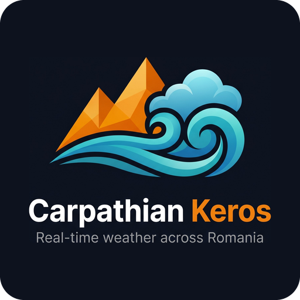

<p align="center">
  
</p>

# Carpathian Keros

[](https://github.com/AlexandruSimionov-XOps/carpathian-keros/actions/workflows/ci.yml)
[](https://github.com/AlexandruSimionov-XOps/carpathian-keros/releases)
[](LICENSE)
[](pyproject.toml)

A bilingual (Romanian / English) weather dashboard for Romania's 319 official cities and towns (the [Wikipedia list](https://ro.wikipedia.org/wiki/Lista_ora%C8%99elor_din_Rom%C3%A2nia)). Search suggests matching cities as you type. It shows current conditions, a 24-hour hourly chart and a 7-day forecast, and you can download any report as a PDF in either language.

Data comes from [Open-Meteo](https://open-meteo.com/), which needs no API key.

Full documentation is in [`docs/`](docs/README.md): a user guide, setup, the API reference, architecture, frontend, i18n, troubleshooting, and an [AI agent guide](docs/ai-agents.md).

## Setup

```bash
python3 -m venv .venv
source .venv/bin/activate        # Windows: .venv\Scripts\activate
pip install -r requirements.txt
python app.py                    # http://127.0.0.1:5000
```

Environment variables (all optional):

| Variable | Default | Purpose |
|---|---|---|
| `HOST` / `PORT` | `127.0.0.1` / `5000` | Bind address |
| `FLASK_DEBUG` | unset | `1` enables the debug reloader |
| `CK_PDF_FONT` / `CK_PDF_FONT_BOLD` | auto-detected | Unicode TTF fonts for the PDF |

**WSL2:** to open the app from a Windows browser, start it with `HOST=0.0.0.0 python app.py` and browse to `http://localhost:5000`. If localhost forwarding is off, use the WSL IP from `hostname -I` instead.

For production, run it under a WSGI server, e.g. `gunicorn -w 2 -b 0.0.0.0:8000 app:app`.

## Tests and tooling

```bash
pip install -r requirements-dev.txt
pytest                                  # unit, API, PDF and JS tests, offline (~2 s)
ruff check . && ruff format --check .
CK_E2E=1 pytest -m e2e                  # optional browser tests (needs Playwright + network)
```

Version: **1.0.0** (`pyproject.toml`). History: [`CHANGELOG.md`](CHANGELOG.md). Project rules for contributors and AI agents: [`AGENTS.md`](AGENTS.md).

## Endpoints

| Route | Description |
|---|---|
| `GET /` | Dashboard UI |
| `GET /api/cities` | The list of allowed cities (used for autocomplete) |
| `GET /api/weather?city=<name>` | Location, current conditions, the next 24 hours and 7 days as JSON. `city` must be on the list |
| `GET /api/report/export?city=<name>&lang=<en\|ro>` | PDF report download |
| `GET /healthz` | Liveness check: `{"status": "ok", "version": "…"}`; never calls Open-Meteo |

Errors come back as `{"error": "<code>", "message": "..."}`. The codes are `invalid_city` (400), `city_not_found` (404) and `upstream_error` (502). The frontend translates each code.

## Docker

```bash
docker build -t carpathian-keros .
docker run --rm -p 8080:8080 carpathian-keros     # → http://localhost:8080
```

Production image: gunicorn, a non-root user, the PDF fonts installed, and an allow-list build context. Details and container tests are in [docs/setup.md](docs/setup.md#run-with-docker).

## Deployment

The target is **Google Cloud Run** (europe-west1, free tier), at `https://carpathian-keros.cloud.run`. All Google Cloud resources are defined with **OpenTofu** in [`infra/`](infra/): Cloud Run, Artifact Registry, Workload Identity Federation (GitHub deploys **without any stored key**) and a budget alert, all tested with a mocked provider in CI. The step-by-step guide is [docs/infrastructure.md](docs/infrastructure.md).

## Structure

```
app.py                     create_app() factory: routes, presets, security headers
data/cities_ro.json          The 319 official cities: name, county, population, coordinates
scripts/build_cities.py      Regenerates data/cities_ro.json from Wikipedia + Open-Meteo Geocoding
services/cities.py           City registry: lookup (diacritic-insensitive), allow-list for suggestions
services/weather_service.py  Open-Meteo forecast client: timeouts, retries, 10-min TTL cache, stale fallback
services/pdf_service.py      fpdf2 report (EN/RO) with a Unicode TTF font
services/i18n.py             Backend labels + WMO code translations (for the PDF)
templates/index.html         Jinja2 page (Tailwind, GSAP, ApexCharts via CDN)
static/js/i18n.js            Frontend translation dictionary + locale helpers
static/js/util.js            escapeHtml, fold
static/js/autocomplete.js    City search suggestions (pure matching + combobox UI)
static/js/app.js             Fetching, rendering, animations, charts
static/fonts/                Self-hosted Inter font (SIL OFL)
tests/                       pytest + Node + Playwright tests, offline fixtures
static/css/style.css         Custom styles
```

## Notes

- **Cities:** only places on `data/cities_ro.json` can be queried. The app never geocodes at runtime. To refresh the list, run `python scripts/build_cities.py`.
- **Caching:** forecast responses are cached in memory for 10 minutes. If Open-Meteo fails and an expired entry exists, the app serves it with `"stale": true` and the UI shows a notice. The cache is per process.
- **PDF fonts:** DejaVu Sans is used when it's installed (`apt install fonts-dejavu-core`). Otherwise the app tries Liberation, Noto or Arial. If none of these are found, it falls back to Helvetica and transliterates the diacritics (`ș → s`), so a PDF is always produced.
- **Language:** the site opens in Romanian. The `RO | EN` toggle is saved in `localStorage`, along with the last city you viewed. The PDF export defaults to `en` when `lang` is omitted, but the UI always sends it.

## Licence

The code is released under the [MIT License](LICENSE). Bundled third-party material keeps its own licence. In particular, the city data in `data/cities_ro.json` is CC BY-SA 4.0 (Wikipedia), and the Inter font is SIL OFL 1.1. See [NOTICE.md](NOTICE.md).

Weather data comes from Open-Meteo, whose free API is for **non-commercial** use. Running this commercially requires an Open-Meteo subscription.
